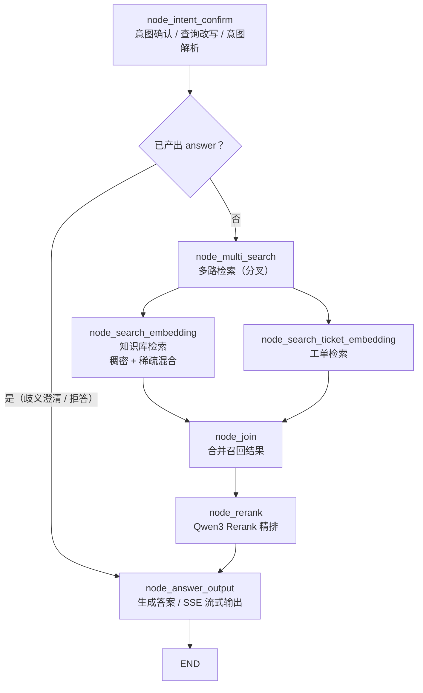
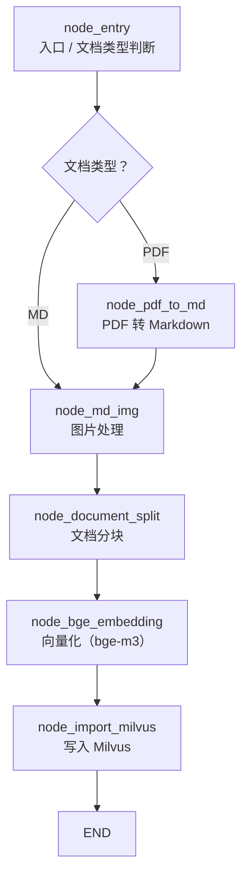
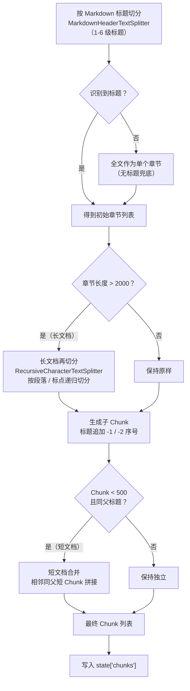

# IT Support Agent

基于 RAG（检索增强生成）的技术支持智能问答系统。通过 LangGraph 编排检索、意图识别与生成流程，结合 Milvus 向量检索与 LLM 提示词生成，为技术支持场景提供精准的问答服务。

## 功能特性

- **混合检索**：稠密向量（bge-m3）+ BM25 稀疏向量双路召回，RRF 融合
- **精排**：Qwen3 Rerank 对召回结果二次排序（可配置开关）
- **意图识别与引导**：查询改写/拆分、意图解析、歧义澄清引导
- **知识库管理**：知识库、文档、分块的增删改查
- **文档导入流水线**：PDF → Markdown → 图片处理 → 分块 → 向量化 → 入库
- **工单检索**：对历史工单进行向量检索
- **流式输出**：SSE 两步式流式问答
- **会话与反馈**：多轮会话管理、消息反馈
- **认证与权限**：JWT 认证、用户/角色管理
- **定时任务**：工单增量同步

## 技术栈

### 后端

- FastAPI、SQLAlchemy 2.0、MySQL（PyMySQL）
- LangChain / LangGraph / LangMem
- pymilvus 3.0（Milvus 向量数据库）
- Redis（token 黑名单、意图树缓存）
- boto3（RestFS，S3 兼容对象存储）
- loguru、schedule、snowflake-id

### LLM

- 对话模型：qwen-max（OpenAI 兼容，阿里云百炼）
- 意图模型：qwen-turbo
- 视觉模型：qwen3-vl-flash
- 向量模型：bge-m3（Ollama 本地部署）
- 精排模型：qwen3-rerank（HTTP API）

### 前端

- React 18 + Vite 5 + Tailwind CSS
- Zustand（状态管理）、Axios（HTTP 客户端）
- react-markdown / KaTeX（Markdown 与公式渲染）

## 系统架构

核心是两条 LangGraph 工作流（模块导入时编译好的 StateGraph）。

### 查询流水线（query_process）



### 导入流水线（import_process）



#### 文档切分细节（node_document_split）



切分阈值：`DEFAULT_MAX_CONTENT_LENGTH = 2000`（超过触发长文档再切分）、`MIN_CONTENT_LENGTH = 500`（低于且同父标题触发短文档合并）。

检索采用混合召回（稠密 embedding + BM25 稀疏向量），RRF 融合，可选 Rerank 精排。

### 流式问答协议

1. `GET /api/rag/v3/chat?question=...&conversation_id=...` — 创建任务，返回 `{task_id, conversation_id}`
2. `GET /api/rag/v3/stream/{task_id}` — 订阅 SSE 流
3. `POST /api/rag/v3/stop` — 取消运行中的任务

## 项目结构

```
it-support-agent/
├── backend/
│   ├── main.py                # FastAPI 主应用
│   ├── controllers/           # HTTP 接口（APIRouter）
│   ├── services/              # 业务逻辑（意图解析、查询改写、会话记忆等）
│   ├── crud/                  # 数据访问
│   ├── models/                # SQLAlchemy ORM 模型
│   ├── schemas/               # Pydantic DTO
│   ├── client/                # 外部客户端单例（Milvus/Redis/LLM/RestFS）
│   ├── workflow/              # LangGraph 工作流
│   │   ├── query_process/     # 查询流水线
│   │   └── import_process/    # 导入流水线
│   ├── conf/                  # 配置对象（@dataclass）
│   ├── core/                  # 核心模块（logger、security）
│   ├── middleware/            # JWT 认证、用户上下文中间件
│   ├── db/                    # SQLAlchemy engine / Session / Base
│   ├── utils/                 # 工具（SSE、embedding/rerank、雪花 ID 等）
│   ├── tasks/                 # 定时任务调度器
│   ├── prompts/               # 提示词模板
│   ├── evals/                 # 评测脚本
│   └── requirements.txt       # Python 依赖
├── frontend/                  # React 前端
│   ├── src/pages/             # 页面（含 admin/）
│   ├── src/components/        # 组件
│   ├── src/services/          # API 服务层
│   └── src/store/             # Zustand 状态管理
├── sql/
│   └── shcema_table.sql       # 数据库表结构
├── docker-compose.yml         # Docker 一键启动
├── Dockerfile
└── .env.example               # 环境变量示例（不含密钥）
```

## 快速开始

### 方式一：Docker Compose（推荐）

```bash
cp .env.example .env   # 填写密钥等配置
docker compose up -d
```

启动的容器：MySQL、Redis、Milvus（etcd + MinIO）、RestFS、后端、前端。向量模型由本地 Ollama 提供（`bge-m3`）。

### 方式二：本地开发

后端：

```bash
python -m venv .venv && source .venv/bin/activate   # Windows: .venv\Scripts\activate
pip install -r backend/requirements.txt
cp .env.example .env
python -m backend.main    # http://localhost:5000，接口文档 /docs
```

前端：

```bash
cd frontend
npm install
npm run dev               # http://localhost:5173，/api 代理到 5000
```

## 环境变量

`.env.example` 已列出全部配置项。关键配置：

| 变量 | 说明 |
|------|------|
| `DATABASE_URL` | MySQL 连接串 |
| `REDIS_*` | Redis 连接 |
| `JWT_SECRET_KEY` | JWT 签名密钥 |
| `LLM_API_BASE` / `LLM_API_KEY` / `LLM_MODEL` | 对话模型（OpenAI 兼容） |
| `SYSTEM_MODEL` / `VL_MODEL` | 意图模型 / 视觉模型 |
| `EMBEDDING_API_URL` / `EMBEDDING_MODEL` | 向量模型（Ollama bge-m3） |
| `RERANK_API_BASE` / `RERANK_MODEL` | 精排模型（qwen3-rerank） |
| `MILVUS_*` | Milvus 向量库连接 |
| `RESTFS_*` | RestFS 对象存储 |
| `MINERU_*` | MinerU 文档解析 |
| `LANGSMITH_*` | LangSmith 追踪（可选） |

## API 接口

| 前缀 | 说明 |
|------|------|
| `/api/auth` | 认证（register/login/refresh/me/logout） |
| `/api/users` | 用户管理 |
| `/api/knowledge-base` | 知识库 / 文档 / 分块管理 |
| `/api/rag/v3` | RAG 问答（chat/stream/stop） |
| `/api/conversations` | 会话管理 |
| `/api/sample-questions` | 示例问题 |
| `/api/feedback` | 消息反馈 |
| `/api/mappings` | 关键词映射 |
| `/api/intent-tree` | 意图树 |

接口文档：`http://localhost:5000/docs`

## 数据库表

`t_user`、`t_conversation`、`t_conversation_summary`、`t_message`、`t_message_feedback`、`t_sample_question`、`t_knowledge_base`、`t_knowledge_document`、`t_knowledge_chunk`、`t_intent_node`、`t_query_term_mapping`、`t_support_ticket`

## 许可证

MIT License
